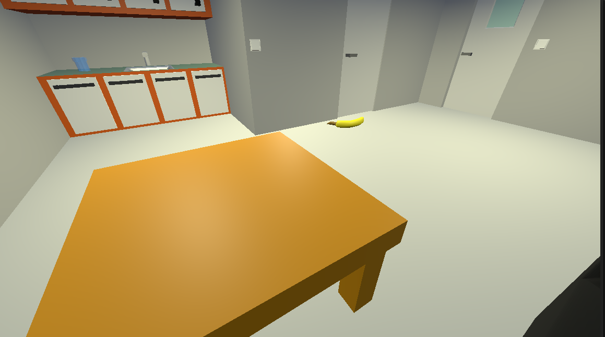

# Game
## Game where you need to get the water cup BUT it isn't as easy as you think >:D

## Goal
Get water but there comes side quests (I only coded one)
## AI
I only used AI to help me with problems and not to generate code.
## Updates
I will keep doing this in the next week.
## Controls
E   Do
WASD    Move
Mouse   Move head
## See this project with your own eyes
If you want to see this project just go to https://fatsermint.github.io/terra-4/ 
## Models
All models are made by so they aren't the best. I used Blender to make them
## Cool features
I think the fact that you can flip lights on and off is pretty cool feature
## Terra
I made this project to terra's week 4
## Why I made this project
I made this project to learn Godot and learn how to make 3d games.
